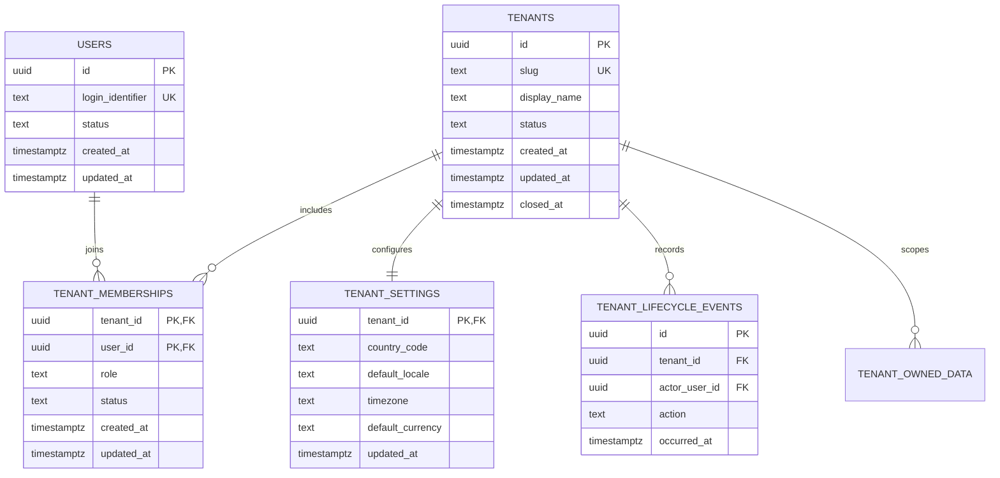

# Phase 1E — Multi-Tenant Foundation Architecture

**Status:** Partial foundation implemented; production tenant isolation is disabled  
**Product principle:** Global product, built from Algeria  
**Scope:** Tenant identity, membership, isolation, and the boundaries needed by
future modules. The requirements and acceptance criteria below remain the
target contract for completing this foundation.

Implementation note (2026-11-04): database tables, tenant-aware constraints,
forced RLS policies, transaction-local context, offline authorization checks,
and gated PostgreSQL integration tests exist. The RLS policies currently rely
on caller-settable settings and are not a trusted identity boundary. Migration
`0003_runtime_tenant_access_lockdown` revokes the production `app_runtime`
role's access to the application schema until a trusted verifier and identity
provider are selected. The migration is not yet applied; keep business data
routes disabled and do not use the runtime role against a provisioned database
until the guarded migration is deployed. No migrations have been applied to a
live database.

Phase 1F adds an optional OIDC JWT-verification adapter for RS256/ES256,
including issuer/audience/time-claim validation and bounded HTTPS discovery
and JWKS retrieval. It is not an HTTP authentication guard, no provider is
configured, and it does not establish trusted database context. This adapter
does not change the production lockout or make tenant isolation production
ready; see [ADR 0001](./adr/0001-enterprise-identity-and-tenant-context.md).

## 1. Goals and non-goals

Phase 1E establishes a secure tenant boundary in the existing NestJS modular
monolith and PostgreSQL foundation. A tenant represents an independent
organization or merchant. The design must support multiple countries,
languages, currencies, and regional configurations without making Algeria a
database or domain assumption.

This phase does not implement full authentication, enterprise IAM, commerce,
billing, AI, automation, analytics, a cloud provider integration, or a frontend
rewrite. Tenant membership must not be mistaken for complete resource-level
authorization. Those capabilities remain separately scoped.

## 2. Current baseline and security caveat

The schema and integration assertions are present, but database isolation is
not production-verified. `DatabaseService.transaction()` can set
`app.tenant_id` transaction-locally, and PostgreSQL custom settings are
user-settable by a role that can issue SQL. Therefore `app.tenant_id` alone is
not authenticated identity and is not a security boundary. The production
`app_runtime` role is denied access to the `app` schema until policies validate
trusted context and the integration tests below pass against an approved
database.

## 3. Domain model

Use PostgreSQL UUID primary keys and application-generated identifiers or
`gen_random_uuid()` according to the final migration convention. All tenant
data has a non-null `tenant_id`; tenant-scoped uniqueness and foreign keys
include `tenant_id` so a valid identifier from another tenant cannot be
referenced accidentally.

| Table                                          | Ownership and key design                                                                                                                           | Main relationships and invariants                                                                                                                                                                                                                                                          |
| ---------------------------------------------- | -------------------------------------------------------------------------------------------------------------------------------------------------- | ------------------------------------------------------------------------------------------------------------------------------------------------------------------------------------------------------------------------------------------------------------------------------------------ |
| `app.users`                                    | IAM-owned global principal; `id` UUID PK; normalized login identifier unique under a documented case-folding rule; lifecycle status and timestamps | One user can have memberships in multiple tenants. Authentication credentials and external identity-provider links belong to IAM-owned tables, not tenant settings.                                                                                                                        |
| `app.tenants`                                  | Core-owned organization; `id` UUID PK; globally unique normalized `slug`; display/legal names; `status`; timestamps; optional `closed_at`          | Parent of memberships and settings. Do not hard-delete tenants with business records.                                                                                                                                                                                                      |
| `app.tenant_memberships`                       | Composite PK `(tenant_id, user_id)`; both FKs use `ON DELETE RESTRICT`; `status`, coarse membership role, timestamps                               | Many-to-many between tenants and users. Membership status must be active and tenant status must permit access. Any tenant with active status must retain at least one active owner; enforce this via a serialized service transaction or a carefully reviewed deferred constraint trigger. |
| `app.tenant_settings`                          | `tenant_id` PK and FK to tenant; one-to-one                                                                                                        | Explicit `country_code`, `default_locale`, `timezone`, and `default_currency`; validate formats against maintained standards data rather than hardcoded Algeria-only enumerations. Do not use a free-form JSON blob for settings that affect security or billing.                          |
| `app.tenant_lifecycle_events` (optional in 1E) | Append-only event ID; tenant FK; actor/principal reference; action and timestamp                                                                   | Add only if no approved shared audit-log facility exists. Avoid duplicating a platform-wide audit module.                                                                                                                                                                                  |

Use `ON DELETE RESTRICT` for tenant-owned data relationships. Lifecycle changes
should archive, suspend, or close records through explicit transitions rather
than cascade-delete business data. A later retention policy may define legally
approved anonymization and purge workflows.

Use a membership role only for the initial coarse tenant-level distinction
(owner/admin/member). It is not a substitute for resource permissions. Move
fine-grained roles, permissions, sessions, and access policies into the
Identity & Access Management domain with explicit migrations when that phase
is authorized.

### Entity relationship diagram



`TENANT_OWNED_DATA` is a diagram placeholder, not a proposed table. Commerce,
AI, automation, market intelligence, and analytics modules own their own
tables and add tenant-scoped composite keys and foreign keys when those modules
are separately approved.

## 4. Tenant isolation and RLS

### 4.1 Trust model

1. Authenticate a global user before tenant selection.
2. Resolve a requested tenant from the authenticated user's active membership;
   never trust a tenant ID from request JSON or an unverified header.
3. Give the data layer a short-lived, tenant-specific authenticated context.
   The database must be able to verify that context independently of an
   arbitrary `SET app.tenant_id` issued by the runtime role.
4. Bind the verified context transaction-locally on the same connection used
   for tenant queries.
5. Apply PostgreSQL RLS to every tenant-owned table, in addition to
   application-level membership checks and authorization.

A plain custom GUC, unsigned tenant ID, or tenant ID copied from a URL is
spoofable by any actor able to issue SQL as the shared runtime role. The
proposed design is a short-lived, tenant-scoped signed context assertion:
authentication/membership authorization issues the assertion; the runtime
sets it with transaction-local scope; a narrowly exposed database helper
validates its signature, issuer, audience, tenant, principal, and expiry before
RLS returns the tenant. Use a provider-supported cryptographic verifier and
keep verification material inaccessible to runtime SQL. Rotate keys and keep
assertion lifetime short to bound revocation delay.

**Provider-neutrality decision still required:** PostgreSQL-native signature
verification may require an extension or provider-specific facility. Before
implementing RLS, verify the chosen managed PostgreSQL service supports the
selected verifier and key-rotation procedure. If not, stop and present an
alternative trust design; do not silently fall back to trusting a tenant GUC.
The RLS tests must prove that a runtime SQL caller cannot substitute another
tenant's unsigned context.

### 4.2 Policies and privileges

- Enable and `FORCE ROW LEVEL SECURITY` on every tenant-owned table.
- Use both `USING` and `WITH CHECK` policies so reads, updates, deletes, and
  inserted/updated row ownership all require the same verified tenant context.
- Fail closed when context is absent, invalid, expired, or refers to an
  inactive tenant/membership.
- Keep authorization helpers in a non-public schema with a fixed `search_path`,
  narrowly scoped `EXECUTE` grants, and reviewed `SECURITY DEFINER` ownership
  if a definer function is required. Do not grant the runtime role ownership,
  superuser, `BYPASSRLS`, or membership that permits assuming an owner role.
- Keep `db_migrator`, schema ownership, runtime access, and any signing/verifier
  key access distinct. Migration credentials are never application
  credentials.
- Add composite foreign keys such as
  `(tenant_id, referenced_id) -> (tenant_id, id)` to prevent cross-tenant
  references even when identifiers are known.
- Do not expose a system-wide bypass flag to ordinary application requests.

Illustrative policy shape only (not executable migration SQL):

```sql
USING (tenant_id = app_private.verified_tenant_id())
WITH CHECK (tenant_id = app_private.verified_tenant_id())
```

The helper must perform cryptographic validation; it must not merely return
`current_setting('app.tenant_id', true)::uuid`.

### 4.3 Transactions, pooling, and asynchronous work

Use only transaction-local context (`SET LOCAL` or parameterized
`set_config(..., true)`) after beginning the transaction. Bind it and all
tenant queries to that transaction's checked-out connection. Never use
session-level `SET`, and do not accept context from caller-controlled SQL
fragments. Commit and rollback must both clear the context before a pooled
connection is reused. Keep ordinary single-tenant operations in explicit
transactions; do not add an implicit transaction around every request without
reviewing streaming and transaction-duration behavior.

Background jobs carry a validated tenant identifier and a user/system actor
with an explicit authorization purpose. Re-check tenant status and the
job-specific authorization at execution time, then create a fresh signed
context and transaction. A global system operation uses a separate, narrowly
scoped service path and audited database functions/role; it must not set an
arbitrary tenant context or reuse an unrestricted application bypass.

## 5. NestJS module design

```text
src/
  identity/                 # future authentication/principal contract
  tenants/
    tenants.module.ts
    tenant.service.ts
    tenant.repository.ts
    tenant-context.ts
    tenant-context.interceptor.ts
    tenant.guard.ts
    tenant.types.ts
  database/
    database.module.ts      # existing pool; explicit tenant transaction API
    schema/
      identity.schema.ts
      tenant.schema.ts
      tenant-membership.schema.ts
      tenant-settings.schema.ts
```

Responsibilities:

- **TenantModule** composes tenant use cases, repository, guards, and context
  providers; it does not own authentication credentials.
- **TenantService** performs lifecycle and membership use cases, enforces
  state transitions, and coordinates a transaction.
- **TenantRepository** owns tenant/member/settings SQL; methods require an
  explicit verified actor/context and avoid unscoped tenant lookups.
- **TenantContext** is an immutable request/job principal (user, tenant,
  assertion, and actor kind) established only after authentication and
  membership authorization. It is not a client-provided `tenantId`.
- **TenantGuard** rejects unauthenticated, inactive, or non-member requests
  and applies coarse tenant role checks. It is not a replacement for
  resource-level authorization.
- **TenantInterceptor** propagates the verified context and correlation data.
  It must not infer authorization or hold a database transaction for the
  entire HTTP request.
- **DatabaseService** exposes a tenant transaction operation that accepts
  verified context, installs transaction-local signed context, and never
  accepts a bare caller-selected tenant ID as proof.

Avoid request-scoped providers by default; use an explicit immutable context
or `AsyncLocalStorage` only where it simplifies propagation without obscuring
transaction ownership. Reuse the existing pool and lifecycle provider.

## 6. Security and integration tests

Add offline unit tests for tenant state transitions, membership authorization,
claim validation behavior, context propagation, and fail-closed missing
context. Add managed-PostgreSQL integration tests on a dedicated isolated
test database using non-production credentials.

Required integration cases:

1. Tenant A cannot read Tenant B rows, including by guessed UUID.
2. Tenant A cannot insert/update rows with Tenant B's `tenant_id`.
3. Cross-tenant composite foreign-key references fail.
4. Missing, malformed, expired, wrong-issuer, wrong-audience, or invalidly
   signed context returns no rows and rejects writes.
5. Changing a GUC to another tenant without a valid assertion does not switch
   RLS identity.
6. User without active membership cannot get a valid context for a tenant.
7. An inactive/suspended tenant and revoked membership cannot be newly
   authorized; revocation delay is bounded by the documented context lifetime.
8. A transaction that commits or rolls back does not leak context into the
   next borrower of a reused pool connection.
9. Concurrent transactions for different tenants on pooled connections remain
   isolated.
10. Background jobs require tenant/actor context and cannot inherit an HTTP
    request's context.
11. Runtime role cannot disable RLS, assume owner/migrator roles, read
    verifier secrets, or use system-level operations.
12. Any system operation is separately authorized, audited, and constrained to
    its declared purpose.

Do not run these tests against production or an unapproved database. No
integration test result may be inferred from unit tests.

## 7. Global SaaS and future module boundaries

- Store tenant locale, timezone, country, and default currency as explicit
  configurable values. Avoid Algeria-specific defaults in shared schema,
  migrations, authorization, or core enums.
- Use country/locale/currency standards with validation and upgrade plans.
  Country-specific tax, shipping, payments, and compliance rules belong in
  regional provider/configuration modules.
- Keep regional market data and evidence in the Market Intelligence domain;
  regional insight must carry source, provenance, confidence, and time range.
- Tenant ownership is a shared boundary, not permission to read another
  module's tables directly. Commerce, AI Studio, Automation, Command Center,
  Analytics, and Billing access their own data through module interfaces.
- Billing plans and entitlements may later constrain tenant features, but
  payment processing is out of this phase and requires separate business and
  compliance approval.
- Preserve the modular monolith; do not add queues, microservices, or a
  provider-specific cloud dependency without an approved need.

## 8. Implementation sequence and dependencies

| Step | Work package                                                                                                                                                                                                                                 | Depends on / exit evidence                            |
| ---- | -------------------------------------------------------------------------------------------------------------------------------------------------------------------------------------------------------------------------------------------- | ----------------------------------------------------- |
| 0    | Resolve decisions: identity source and user ID contract; supported PostgreSQL baseline; signed-context verification capability on the selected managed service; context lifetime/revocation target; initial owner and tenant lifecycle rules | Owner decisions; no provider or extension assumed     |
| 1    | Specify schema migration conventions and role grants; define tenant/user/membership/settings constraints and lifecycle transitions                                                                                                           | Step 0; reviewed schema and migration plan            |
| 2    | Implement tenant schema and repository/service use cases; add composite tenant-aware keys/FKs and deterministic lifecycle rules                                                                                                              | Step 1; offline typecheck and unit coverage           |
| 3    | Implement authenticated tenant context contract and transaction-local propagation; remove bare tenant-ID-as-authority semantics                                                                                                              | Identity/principal contract from Step 0               |
| 4    | Implement and review the signed-context verifier, private helper, RLS policies, and runtime least-privilege grants                                                                                                                           | Provider verifier decision; dedicated test DB         |
| 5    | Add guard/interceptor and authorization boundaries, then background-job/system actor paths                                                                                                                                                   | Steps 2–4                                             |
| 6    | Run the full isolated database security matrix, including pool reuse and privilege-escalation cases                                                                                                                                          | Approved isolated managed test DB and test-only roles |
| 7    | Document operations, key rotation, membership revocation, tenant lifecycle, backup/restore implications, and evidence                                                                                                                        | Passing tests and reviewed security design            |

Do not parallelize schema grants, RLS/helper implementation, and application
context code until their shared trust contract is approved. Independent unit
test fixtures and documentation can be developed in parallel after the
contract is fixed.

## 9. Phase 1E acceptance criteria

Phase 1E is complete only when all are evidenced:

- Approved user/principal and tenant-context trust contract.
- Tenant, user, membership, and settings migrations with reviewed constraints,
  foreign keys, lifecycle behavior, and ownership grants.
- Every tenant-owned table has enabled and forced RLS plus reviewed
  `USING`/`WITH CHECK` policies.
- Runtime cannot own tenant tables, bypass RLS, assume migration/owner roles,
  forge a tenant assertion, or access verifier key material.
- Authenticated membership, tenant lifecycle, and role checks are enforced at
  API and database boundaries.
- Transaction-local context is set on the same connection as tenant queries
  and cannot leak across pooled transactions or jobs.
- All required cross-tenant, missing/invalid-context, pooling, background-job,
  and privilege-escalation integration tests pass against an isolated
  managed PostgreSQL database.
- Key rotation, context expiry/revocation, auditability, operational
  procedures, and rollback plan are documented.
- TypeScript, unit tests, lint, formatting, build, and security review pass.

No RLS or tenant-isolation PASS may be claimed before the trusted database
context, role grants, and cross-tenant integration evidence exist. The current
GUC policies and integration-role tests do not meet this criterion.

## 10. Open decisions and risks

1. Identity provider and canonical global user ID are not selected.
2. Cloud provider and managed PostgreSQL capabilities remain undecided.
3. Signed-context verification mechanism, extension availability, key storage,
   rotation, and revocation latency need approval.
4. Tenant ownership transfer, last-owner protection, suspension/reactivation,
   closure, retention, and deletion policy need product/legal decisions.
5. Initial coarse membership roles and the boundary with future IAM require
   agreement.
6. Region placement and data-residency behavior are not defined. Tenant
   settings alone do not provide data residency.
7. Database integration tests require a separately approved isolated managed
   test instance; local containers are not a project dependency.

Until decisions 1–3 are resolved, the signed-context and RLS implementation
must remain blocked. A plain transaction-local tenant GUC is not an acceptable
fallback.
